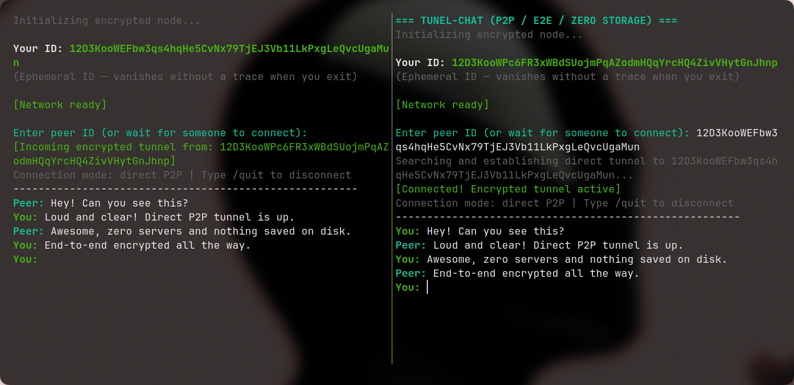
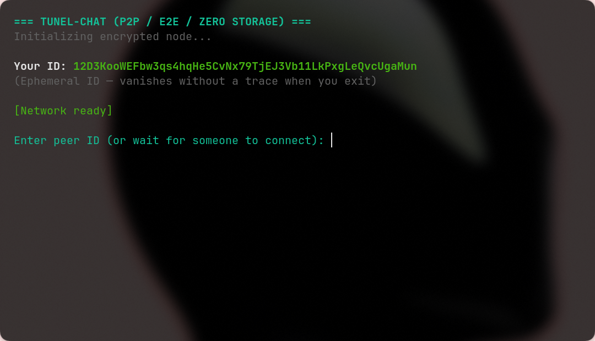

# tunel-chat

A lightweight, zero-storage, end-to-end encrypted P2P terminal chat. Connect any two computers anywhere in the world using only an ephemeral Peer ID — no central server, no accounts, no disk writes, and no port forwarding required.

## Preview

**Live Encrypted P2P Chat:**



**Startup & Ephemeral Peer ID:**



## Features

- **Direct P2P Tunnel:** Uses QUIC/TCP with automatic NAT traversal (UPnP, Hole Punching, and E2E-encrypted AutoRelay fallback).
- **End-to-End Encrypted:** Secured by Noise / TLS 1.3 via `libp2p`.
- **Zero Storage:** Ephemeral Ed25519 keys are generated in RAM on startup. Nothing is ever written to disk — closing the terminal wipes everything.
- **Single Standalone Binary (~25 MB):** Zero runtime dependencies. Works out of the box on Windows, Linux, and macOS.

---

## Quick Install & Run

Install once, then run `tunel-chat` from anywhere in your terminal.

### Windows (PowerShell)

```powershell
iwr https://github.com/filipboski1313-a11y/tunel-chat/releases/latest/download/tunel-chat-windows-amd64.exe -OutFile "$env:LOCALAPPDATA\Microsoft\WindowsApps\tunel-chat.exe"
tunel-chat
```

### Linux (x86_64)

```bash
sudo curl -L https://github.com/filipboski1313-a11y/tunel-chat/releases/latest/download/tunel-chat-linux-amd64 -o /usr/local/bin/tunel-chat && sudo chmod +x /usr/local/bin/tunel-chat && tunel-chat
```

### macOS

**Apple Silicon (M1 / M2 / M3 / M4):**

```bash
sudo mkdir -p /usr/local/bin && sudo curl -L https://github.com/filipboski1313-a11y/tunel-chat/releases/latest/download/tunel-chat-macos-arm64 -o /usr/local/bin/tunel-chat && sudo chmod +x /usr/local/bin/tunel-chat && tunel-chat
```

**Intel Mac:**

```bash
sudo mkdir -p /usr/local/bin && sudo curl -L https://github.com/filipboski1313-a11y/tunel-chat/releases/latest/download/tunel-chat-macos-amd64 -o /usr/local/bin/tunel-chat && sudo chmod +x /usr/local/bin/tunel-chat && tunel-chat
```

*(If macOS blocks the binary on first run, run `sudo xattr -d com.apple.quarantine /usr/local/bin/tunel-chat` once.)*

---

## How to Use

1. Start `tunel-chat` on both computers.
2. Each computer displays its temporary ID:
   ```text
   Your ID: 12D3KooW...
   ```
3. On one computer, paste the other computer's ID and press **Enter**.
4. The encrypted tunnel opens automatically on both terminals — start chatting!
5. Type `/quit` (or press `Ctrl+C`) to close the tunnel and wipe the session.

---

## Build from Source

Requires Go 1.22+:

```bash
git clone https://github.com/filipboski1313-a11y/tunel-chat.git
cd tunel-chat
go build -ldflags="-s -w" -o tunel-chat .
./tunel-chat
```
